# Envios Service — Diagnóstico y Mejora Guiada por Métricas

Post-contenido de la Unidad 10 de Patrones de Diseño de Software. Proyecto Maven plano
(Java 21, sin Spring Boot) que calcula el costo de un envío según método de transporte,
peso, distancia, fragilidad y tipo de cliente. En la versión original,
`ServicioCalculoEnvio.calcularCosto()` concentraba toda la lógica en una cadena de
condicionales, y la suite de partida solo cubría dos caminos. La Parte 1 diagnostica el
problema con métricas reales de SonarQube y JaCoCo; la Parte 2 lo corrige con Strategy y
pruebas significativas, y lo verifica con un Quality Gate propio.

## Resultado

| Métrica | Antes | Después |
|---|---|---|
| Complejidad ciclomática de calcularCosto() | 20 | 5 (−75%) |
| Cobertura de ramas | 18.4% | 100% (+81.6 puntos) |
| Code Smells con "Estándar Laboratorio" | 1 | 0 |
| Duplicación | 0.0% | 0.0% |
| Quality Gate "Estándar Laboratorio" | Failed | Passed |

## Decisiones de diseño
1. **Entorno de análisis: SonarQube local con Docker.** Es la única opción que permite
   crear el Quality Profile y el Quality Gate propios que exige el Paso 9; además no
   depende de conectividad ni de cuotas. [Detalle](#entorno-de-análisis)
2. **Exclusiones: ninguna.** Todo `src/main/java` es lógica de negocio, sin `Main` ni código
   generado. [Detalle](#exclusiones-del-análisis)
3. **Señal principal: complejidad ciclomática.** Cuenta caminos independientes, explica la
   cobertura baja y es la métrica que limita S1541. [Detalle](#interpretación)
4. **Patrón: Strategy.** El método no guarda estado (descarta State) ni encadena
   manejadores con orden relevante (descarta Chain of Responsibility); cada rama calcula un
   costo con su propia fórmula, elegida una sola vez por `metodoEnvio`.
   [Detalle](#elección-del-patrón)
5. **Pruebas: una por cada rama que JaCoCo marcó sin cubrir**, con valores calculados de
   forma independiente y límites de distancia probados a ambos lados.
   [Detalle](#pruebas-agregadas)
6. **Umbrales: CC 10 por método y 70% de cobertura.** CC 10 es el techo de "Moderada" en la
   Tabla 3.2 de la guía; 100% de cobertura incentivaría pruebas triviales.
   [Detalle](#quality-gate-estándar-laboratorio)

---

# Parte 1 — Diagnóstico con métricas reales

## Entorno de análisis

**Decisión de diseño 1 — SonarQube local con Docker (Opción A).** Se levantó con el
comando del enunciado (`docker run ... sonarqube:community`). La versión resultante fue
SonarQube Community Build v26.11.0.134175. Criterios:

- **Control total de la configuración.** La Parte 2 exige crear un Quality Profile y un
  Quality Gate propios ("Estándar Laboratorio"). El plan gratuito de SonarQube Cloud no
  permite Quality Gates ni Quality Profiles personalizados (solo los planes Team y
  Enterprise), así que con SonarCloud el Paso 9 no se podría cumplir.
- **Sin dependencia de conectividad ni de límites de un plan gratuito.** El análisis corre
  contra `http://localhost:9000` y el resultado no depende de cuotas externas.
- **Costo aceptado.** El servidor consume recursos locales y debe quedar encendido durante
  todo el laboratorio; el dashboard no es accesible desde otro equipo, por eso la evidencia
  queda en las capturas de `docs/`.

La instancia trae por defecto el modo MQR, que renombra los Code Smells como
"Maintainability issues". Se cambió a **Standard Experience** (Administration → General →
Mode) para que las métricas y las condiciones del Quality Gate coincidan con la
terminología de la guía (Code Smells, New Code Smells).

## Exclusiones del análisis

**Decisión de diseño 2 — no se excluye ninguna clase.** El proyecto no tiene clase de
arranque (`Main`), código generado ni configuración: todo `src/main/java` es lógica de
negocio. Excluir algo solo alteraría el porcentaje de cobertura sin reflejar mejor la
calidad del código que importa. La decisión queda comentada en `sonar-project.properties`.

Nota técnica: `mvn sonar:sonar` usa SonarScanner for Maven, que **no lee**
`sonar-project.properties` (ese archivo es para el SonarScanner CLI). Por eso las mismas
propiedades (`sonar.projectKey`, `sonar.projectName`, `sonar.host.url`,
`sonar.coverage.jacoco.xmlReportPaths`, etc.) están replicadas en `pom.xml`.

## Estado inicial del análisis

Comando: `mvn clean verify sonar:sonar -Dsonar.token=***` (2 pruebas, 0 fallos).

| Métrica | Valor real observado |
|---------|----------------------|
| Complejidad ciclomática de calcularCosto() | 20 |
| Complejidad cognitiva de calcularCosto() | 32 |
| Cobertura de líneas de ServicioCalculoEnvio | 23.8% (10 de 42 líneas) |
| Cobertura de ramas de ServicioCalculoEnvio | 18.4% (7 de 38 condiciones) |
| Cobertura total (SonarQube) | 21.3% |
| Code Smells reportados | 0 |
| Duplicación | 0.0% |
| Quality Gate (Sonar way por defecto) | Passed |

## Interpretación

**Qué método concentra el problema.** SonarQube informa la complejidad por archivo:
`ServicioCalculoEnvio.java` tiene complejidad ciclomática 20 y una sola función
(`functions = 1`), así que los 20 puntos pertenecen enteros a `calcularCosto()`. El valor
coincide con el conteo manual de la guía (CC = 1 + 19 puntos de decisión: 4 de la cadena
de métodos de envío, 12 de tramos de peso y de condiciones por distancia, 1 de fragilidad y 2 de
tipo de cliente). Está en el rango "Alta" de la Tabla 3.2 de la guía.

**Qué ramas quedaron sin cubrir.** El reporte HTML de JaCoCo (`docs/jacoco-inicial.png`)
marca 31 de 38 ramas sin ejercitar. Las dos pruebas de partida solo recorren ESTANDAR con
3 kg y 100 km, sin fragilidad, para un cliente REGULAR y uno PREMIUM:

- **Sin ejercitar en absoluto:** los métodos EXPRESS (líneas 19 a 30), OVERNIGHT (31 a 41,
  incluida la excepción por más de 300 km) e INTERNACIONAL (42 a 52, incluido el recargo
  por más de 5000 km), y el `else` que rechaza un método no soportado (línea 54).
- **Parciales:** dentro de ESTANDAR solo se tomó el tramo de peso `<= 5`; los tramos
  5–20 kg y más de 20 kg (líneas 11 a 14) y el recargo por más de 500 km (línea 17) nunca
  se ejecutaron. Tampoco el recargo por fragilidad (línea 58) ni el descuento CORPORATIVO
  (línea 64).
- **Única condición cubierta en ambos sentidos:** `tipoCliente.equals("PREMIUM")`
  (línea 61), gracias a la segunda prueba.

**Por qué coinciden complejidad alta y cobertura baja.** Apuntan al mismo método porque
toda la lógica vive en él: cada punto de decisión agrega un camino independiente, y la
complejidad ciclomática es justamente el número mínimo de casos necesarios para cubrir
todas sus ramas. Con CC = 20 y solo 2 pruebas, la cobertura de ramas no podía pasar de un
porcentaje bajo.

**Por qué SonarQube reporta 0 Code Smells.** En esta versión el perfil por defecto para
Java ya no se llama "Sonar way" sino **"Sonar way core"** (263 reglas), y no activa
ninguna regla de complejidad: ni S1541 (complejidad ciclomática por método) ni S3776
(complejidad cognitiva). El problema existe en las métricas pero no genera ningún issue
ni hace fallar el Quality Gate por defecto. Esto se corrige en la Parte 2 con un Quality
Profile propio.

**Decisión de diseño 3 — señal principal: complejidad ciclomática.** De las tres señales
disponibles se usó la ciclomática (20) para elegir el método a intervenir, con la
cobertura como confirmación:

- Es la única de las tres que cuenta caminos independientes, así que explica directamente
  la cobertura baja y dice cuántos casos de prueba hacen falta.
- La complejidad cognitiva (32) también es alta, pero mide la dificultad de lectura (castiga
  el anidamiento) y no se traduce en un número de pruebas. Además, la regla de complejidad
  por método que pide el Quality Gate de la Parte 2 (S1541) limita la ciclomática.
- La cobertura sola (18.4% de ramas) diría "faltan pruebas", pero no que el problema es de
  diseño: escribir 20 pruebas contra un método de más de 60 líneas lo dejaría igual de frágil ante
  cambios. La ciclomática es la que justifica refactorizar antes de completar las pruebas.

## Capturas del análisis inicial

Dashboard del proyecto (Overall Code): Quality Gate Passed, 0 Code Smells, 21.3% de cobertura.
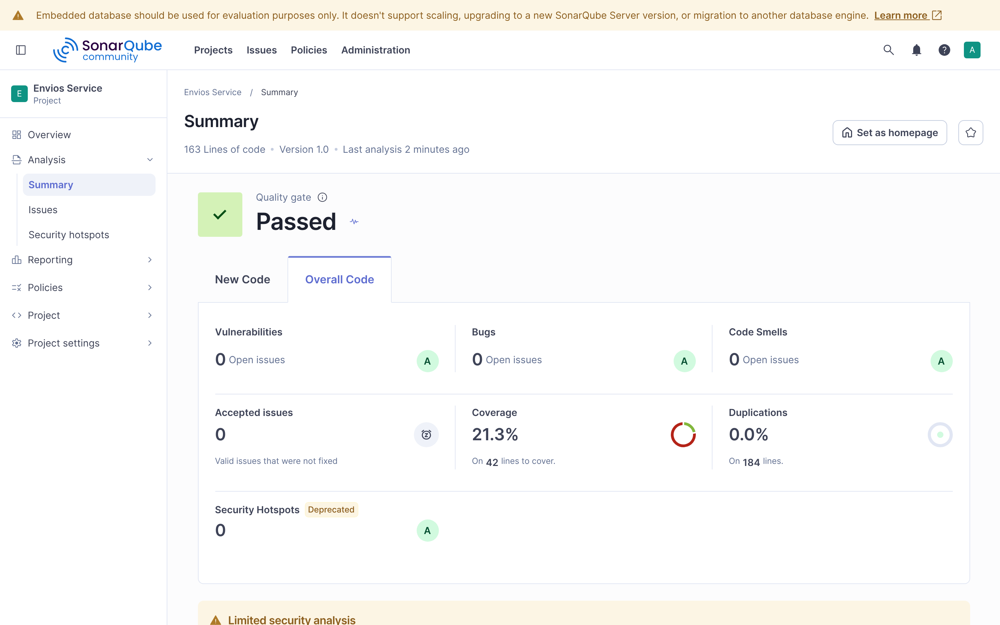

Measures → Complexity: complejidad ciclomática 20 en `ServicioCalculoEnvio.java`.
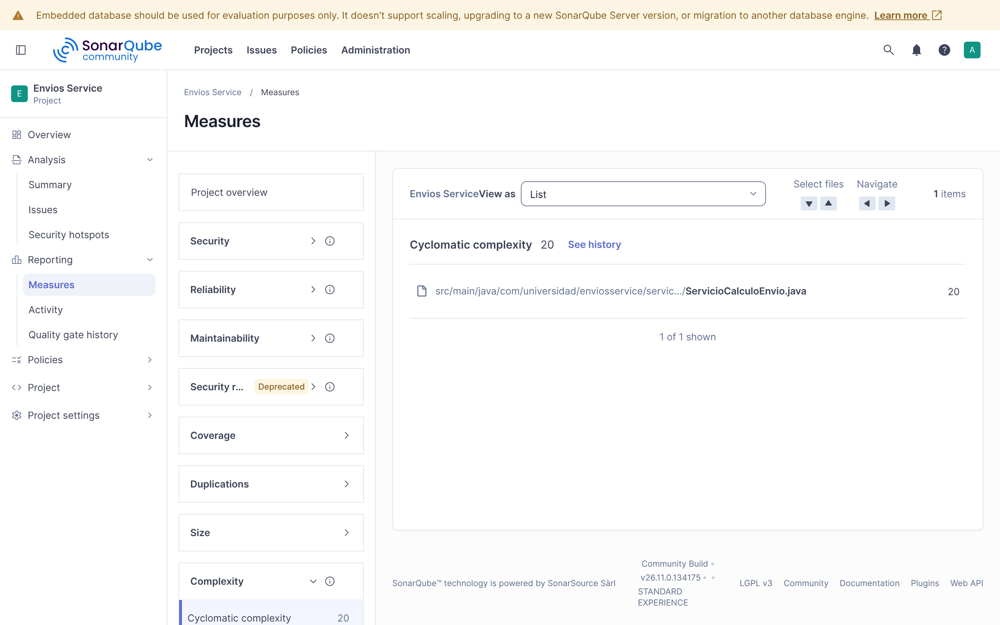

Measures → Coverage: 18.4% de cobertura de condiciones, 31 condiciones sin cubrir.
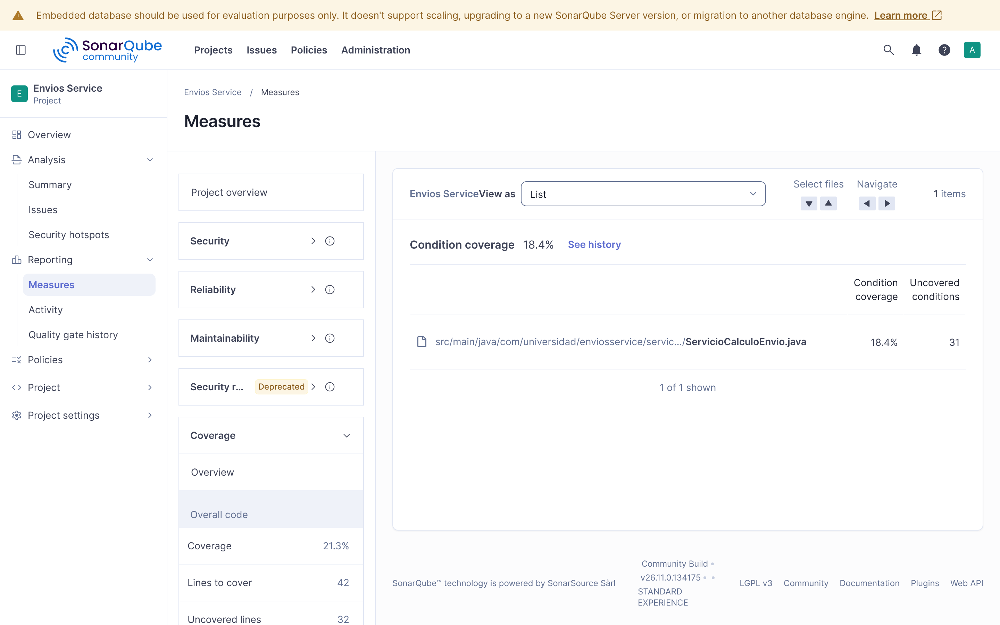

Reporte HTML de JaCoCo: en rojo las ramas nunca ejecutadas, en amarillo las parciales.
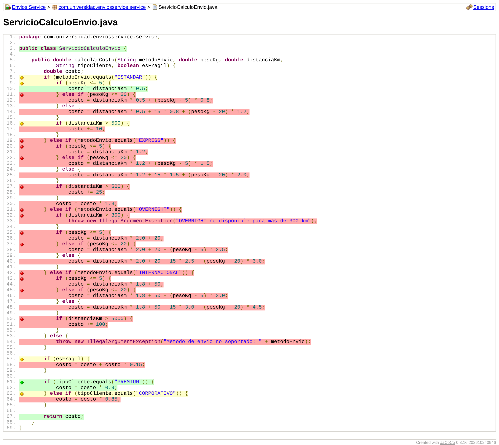

---

# Parte 2 — Refactorización guiada por métricas

## Elección del patrón

**Decisión de diseño 4 — Strategy.** Antes de escribir código se contrastó
`calcularCosto()` con las tres señales de la tabla del Paso 7:

- **State queda descartado** porque el método no guarda estado entre llamadas: todo lo
  que usa son parámetros y variables locales, y `ServicioCalculoEnvio` no tiene campos
  mutables. Llamarlo dos veces con los mismos argumentos da siempre el mismo resultado; no
  hay transiciones entre estados que validar.
- **Chain of Responsibility queda descartado** porque no existe una secuencia de
  manejadores donde el orden importe ni donde varios puedan aplicar. Las ramas de
  `metodoEnvio` son mutuamente excluyentes: se comparan por igualdad contra un valor
  discreto, así que exactamente una se ejecuta y reordenarlas no cambia el resultado.
- **Strategy encaja** porque cada rama calcula el mismo tipo de resultado (un costo) con
  una fórmula propia, elegida una sola vez a partir de un valor discreto de entrada, sin
  relación de orden ni de estado con las demás ramas.

**Qué se movió y qué se quedó.** A cada estrategia (`estrategia/`) se movió lo que
depende del método de envío: la tarifa por tramos de peso, el recargo o la restricción por
distancia (más de 500 km, más de 5000 km, máximo 300 km para OVERNIGHT, con su excepción)
y el factor 1.3 de EXPRESS. En el orquestador se quedaron, a propósito, la selección
(`Map<String, EstrategiaEnvio>` con la excepción para un método no soportado) y los dos
ajustes transversales, fragilidad (+15%) y tipo de cliente (−10% / −15%). Esos ajustes se
aplican igual a todos los métodos de envío; meterlos en cada estrategia los habría
duplicado cuatro veces. Por eso el orquestador no baja a CC 1 sino a 5 (1 base + estrategia
nula + fragilidad + dos ramas de tipo de cliente).

**Segunda iteración, guiada por el Quality Gate.** El primer análisis después del refactor
falló por **10.0% de líneas duplicadas** (límite 5%): SonarQube detectó como bloque
idéntico las líneas 4–15 de `EnvioEstandarStrategy` y `EnvioExpressStrategy`, que repetían
la misma estructura de tramos y solo cambiaban constantes. La fórmula por tramos aparecía
cuatro veces con distintos coeficientes, así que se extrajo a `TarifaPorTramos`, un
`record` con la tarifa por km, el cargo fijo y la tarifa por kilo de cada tramo. No es un
patrón nuevo: las cuatro clases siguen siendo las estrategias intercambiables, y cada una
quedó con lo que realmente la distingue (sus tarifas y su regla de distancia). El
siguiente análisis dio 0.0% de duplicación.

**Comportamiento preservado.** Además de las pruebas, se comparó la versión original de
`calcularCosto()` con la refactorizada sobre 2 400 combinaciones de entrada (los cinco
métodos, incluido uno no soportado; pesos y distancias en cada límite; los tres tipos de
cliente; con y sin fragilidad). Ambas versiones devolvieron exactamente el mismo valor, o
la misma excepción con el mismo mensaje, en todas, tanto tras el primer refactor como tras
extraer `TarifaPorTramos`.

## Pruebas agregadas

**Decisión de diseño 5 — cada prueba nueva corresponde a una rama que el reporte JaCoCo
de la Parte 1 dejó sin cubrir.** La suite pasó de 2 a 38 ejecuciones (los
`@ParameterizedTest` cuentan una por fila) y cada valor esperado se calculó de forma
independiente a partir de las fórmulas.

| Rama sin cubrir en la Parte 1 (línea original) | Prueba que ahora la ejercita |
|---|---|
| ESTANDAR 5–20 kg y más de 20 kg (11–14) | `EnvioEstandarStrategyTest.calculaCostoPorTramoDePeso` (8, 20 y 25 kg) |
| ESTANDAR más de 500 km (16–17) | `EnvioEstandarStrategyTest.aplicaRecargoSoloPorEncimaDe500Km` (500 y 600 km) |
| EXPRESS completo: tramos, recargo y factor 1.3 (19–30) | `EnvioExpressStrategyTest` (7 casos) y `ServicioCalculoEnvioTest.delegaEnLaEstrategiaDelMetodoDeEnvio[EXPRESS]` |
| OVERNIGHT más de 300 km, la excepción (32–33) | `EnvioOvernightStrategyTest.rechazaDistanciasMayoresA300Km` (301 km, verifica el mensaje) y `aceptaExactamente300Km` |
| OVERNIGHT tramos de peso (35–40) | `EnvioOvernightStrategyTest.calculaCostoPorTramoDePeso` |
| INTERNACIONAL tramos y más de 5000 km (42–51) | `EnvioInternacionalStrategyTest` (7 casos, incluye 5000 y 6000 km) |
| Método no soportado (54) | `ServicioCalculoEnvioTest.rechazaMetodoDeEnvioNoSoportado` (verifica el mensaje) |
| Recargo por fragilidad (57–58) | `ServicioCalculoEnvioTest.aplicaRecargoPorFragilidad` y `aplicaFragilidadAntesDelDescuentoPorCliente` (fija el orden: 50 × 1.15 × 0.9 = 51.75) |
| Descuento CORPORATIVO (63–64) | `ServicioCalculoEnvioTest.aplicaDescuentoClienteCorporativo` |

`delegaEnLaEstrategiaDelMetodoDeEnvio` cubre además lo que el refactor introdujo: que cada
clave del mapa apunte a su estrategia correcta.

Dos aclaraciones sobre los valores límite, para no inflar lo que verifican:

- **Distancia.** En 300, 500 y 5000 km la tarifa cambia de golpe (excepción o recargo),
  así que probar ambos lados del límite detecta un `>` escrito como `>=`. Se comprobó
  mutando temporalmente `distanciaKm > 500` a `>= 500` en `EnvioEstandarStrategy`: la
  prueba de 500 km falló.
- **Peso.** En 5 kg y en 20 kg la tarifa es continua: las dos fórmulas vecinas dan el mismo
  valor, así que esas filas no distinguen un `<=` de un `<`. Lo que verifican es que no haya
  salto de precio en el cambio de tramo, y así lo dicen sus comentarios.

Por último, se corrigió un valor del enunciado: para OVERNIGHT con 25 kg y 100 km el costo
es 100 × 2.0 + 20 + 15 × 2.5 + 5 × 3.0 = **272.5**, no 250.0. Con el valor del enunciado la
prueba falla contra el código original.

## Quality Gate "Estándar Laboratorio"

**Quality Profile.** En SonarQube 26.11 no existe un perfil "Sonar way" para Java: el perfil
por defecto es su sucesor, "Sonar way core". Se copió como **"Estándar Laboratorio"**, se
activó **S1541** ("Methods should not be too complex") con `Threshold = 10` y se asignó al
proyecto (264 reglas activas: las 263 del perfil base más S1541).

**Quality Gate.** Se creó "Estándar Laboratorio" con las tres condiciones del enunciado y se
asignó al proyecto:

| Alcance | Condición | Umbral |
|---|---|---|
| Overall Code | Coverage is less than | 70% |
| New Code | Code Smells is greater than | 0 |
| Overall Code | Duplicated Lines (%) is greater than | 5% |

SonarQube 26.x agrega automáticamente cuatro condiciones "Clean as You Code" a todo Quality
Gate nuevo (cobertura de código nuevo < 80%, duplicación de código nuevo > 3%, issues
nuevos > 0 y hotspots revisados < 100%). Se eliminaron para que el gate evalúe exactamente
las tres condiciones que justifica la Decisión 6.

**Verificación sobre el código original.** Antes de analizar el refactor, el código de la
Parte 1 se volvió a analizar con el perfil y el gate nuevos. Con S1541 activa apareció el
Code Smell que el perfil por defecto no mostraba, nombrando el método de forma explícita:
*"The Cyclomatic Complexity of this method "calcularCosto" is 20 which is greater than 10
authorized."* El gate dio **Failed** por la cobertura (21.3% < 70%).

**Decisión de diseño 6 — realismo de los umbrales.**

- **CC = 10 por método, y no 5 ni 20.** Según la Tabla 3.2 de la guía, 10 es el techo del
  rango "Moderada", y es también el valor por defecto del parámetro `Threshold` de S1541.
  Con 5, métodos perfectamente legibles (como el orquestador, que quedó en CC 5) estarían al
  borde del rechazo. Con 20, el método original habría pasado sin aviso. 10 exige que nadie
  vuelva a concentrar la lógica en un solo método, sin obligar a reescribir métodos que aún
  son razonables de mantener.
- **70% de cobertura, y no 100%.** Exigir 100% crea un incentivo perverso (Sección 2.3 de la
  guía): se escriben pruebas triviales que ejecutan líneas sin verificar nada solo para
  llenar el número. 70% deja margen para código de infraestructura y sigue rechazando lo que
  de verdad importa: el código original, con 21.3%, falló.
- **Code Smells nuevos > 0.** La condición se aplica solo al código nuevo, así que no castiga
  deuda heredada pero impide que un cambio introduzca un método que supere CC 10.
- **Duplicación 5%.** El umbral resultó realista en la práctica: no saltó por coincidencias
  menores, pero sí detectó un bloque real de 12 líneas repetidas entre dos estrategias. Hay
  que leerlo en contexto: en un proyecto de unas 200 líneas, un solo bloque duplicado ya
  representa el 10%, así que en proyectos tan pequeños este umbral es estricto.

## Comparación antes / después

| Métrica | Antes (Parte 1) | Después (Parte 2) |
|---------|------------------|--------------------|
| Complejidad ciclomática de calcularCosto() | 20 | 5 (−75%) |
| Complejidad ciclomática máxima por archivo | 20 | 5 (`ServicioCalculoEnvio`); estrategias 2, `TarifaPorTramos` 3 |
| Complejidad cognitiva total | 32 | 11 |
| Cobertura de ramas de la lógica de envío | 18.4% (7 de 38) | 100% (+81.6 puntos) |
| Cobertura de líneas | 23.8% | 100% |
| Code Smells con "Estándar Laboratorio" (S1541) | 1 (calcularCosto, CC 20) | 0 |
| Duplicación | 0.0% | 0.0% (10.0% en la iteración intermedia) |
| Pruebas ejecutadas | 2 | 38 |
| Quality Gate "Estándar Laboratorio" | Failed (cobertura 21.3% < 70%) | **Passed** |

El historial del proyecto en SonarQube (Activity) muestra la secuencia completa: primer
análisis con el perfil por defecto, cambio a "Estándar Laboratorio" con el gate en Failed,
la iteración que falló por duplicación y el análisis final en Passed.

## Capturas de la Parte 2

Código original con el perfil y el gate nuevos: S1541 marca `calcularCosto` y el gate falla.
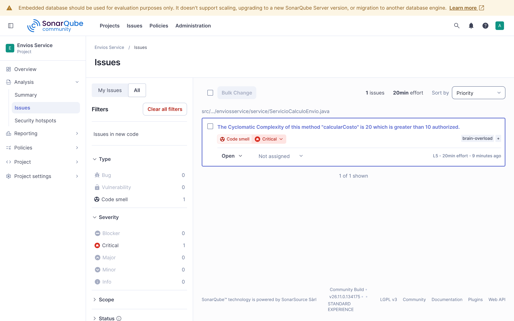
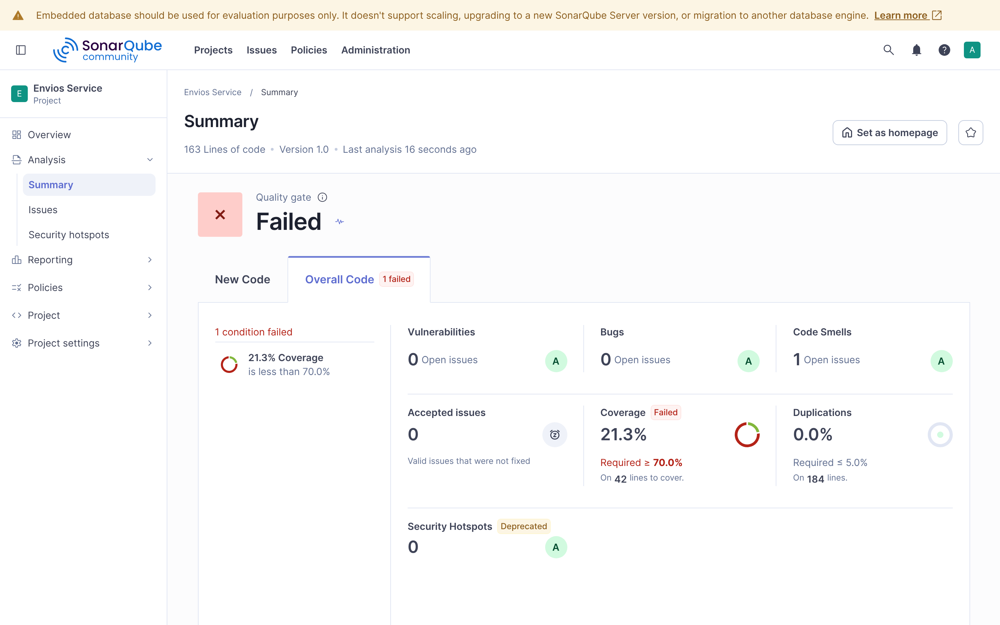

Primer análisis tras aplicar Strategy: el gate falla por duplicación entre estrategias.
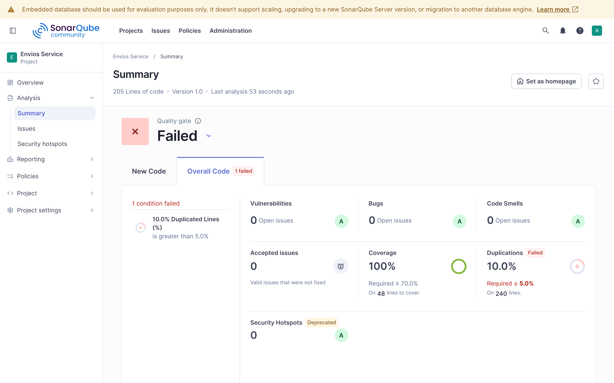
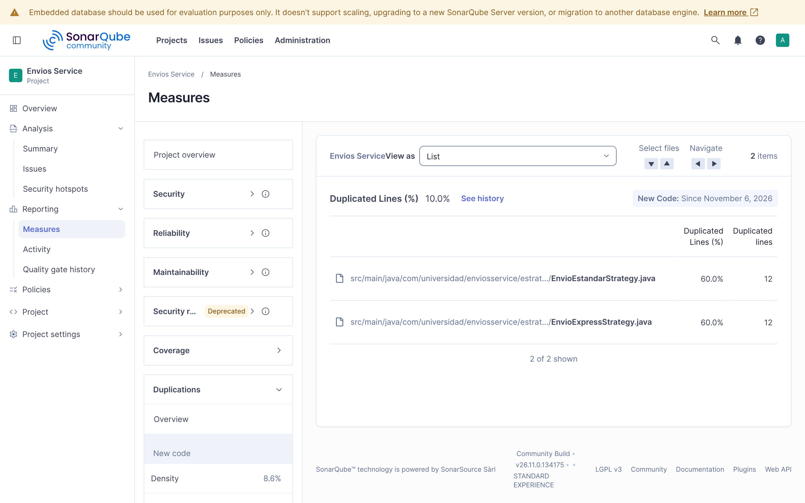

Configuración: Quality Gate con sus tres condiciones y S1541 activa con Threshold 10.
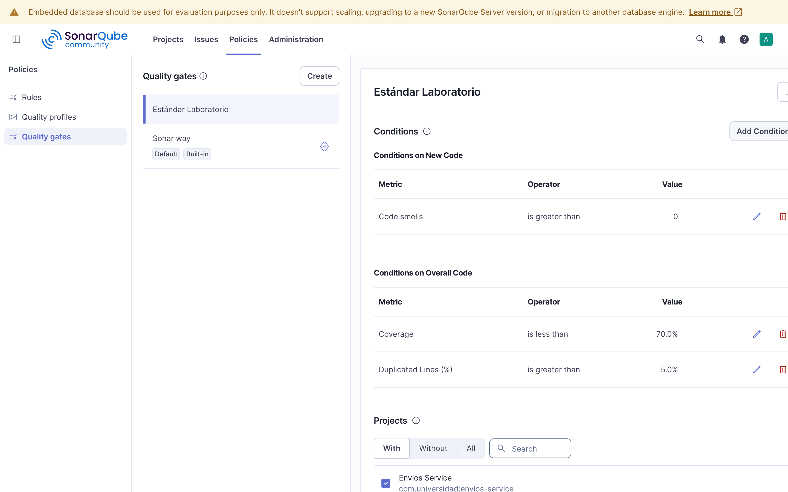
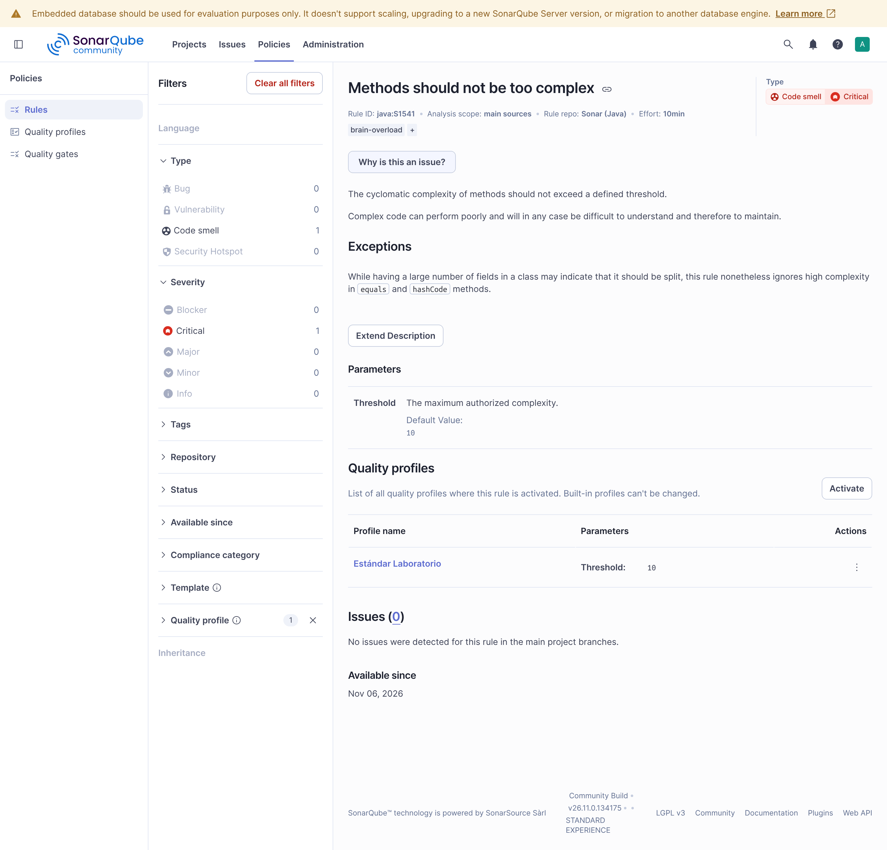

Análisis final: Quality Gate Passed, cobertura 100%, duplicación 0.0%.
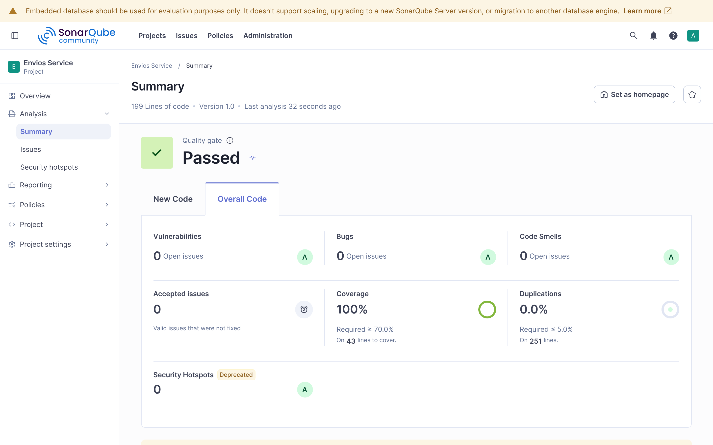
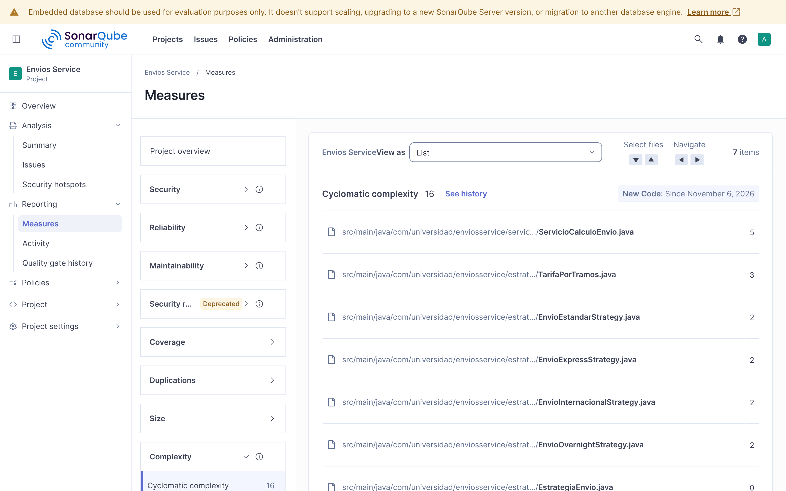
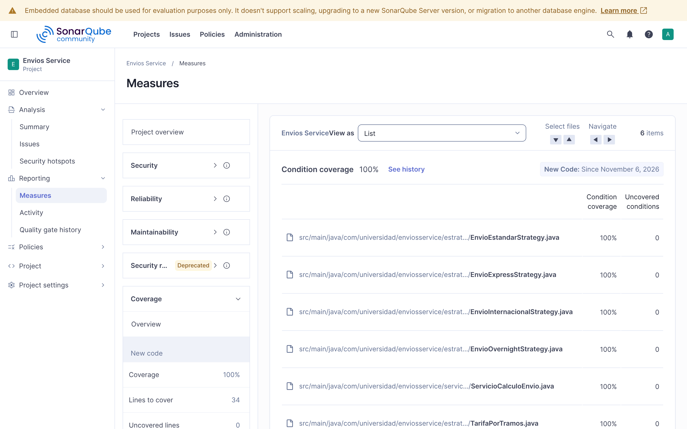
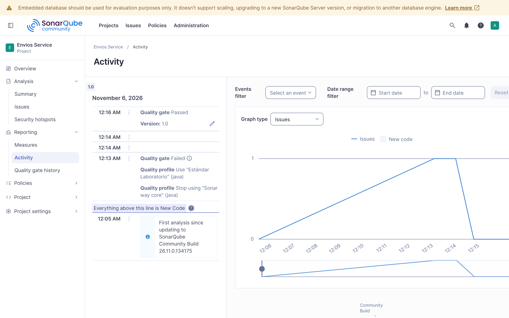

Reporte JaCoCo final: 100% de instrucciones y ramas.
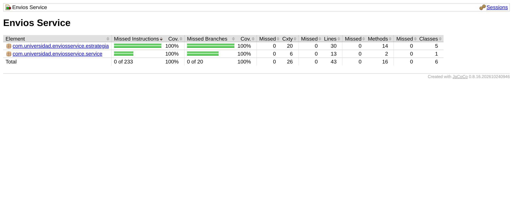
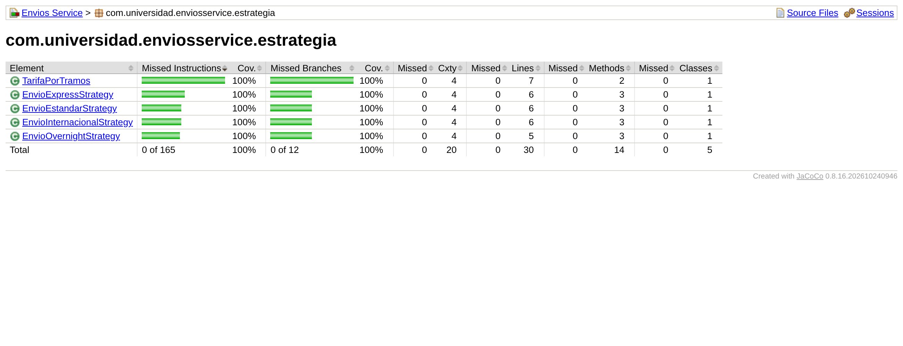

---

## Ejecutar el análisis
```bash
# 1. Levantar SonarQube local (esperar "SonarQube is operational" en docker logs)
docker run -d --name sonarqube -p 9000:9000 \
  -e SONAR_ES_BOOTSTRAP_CHECKS_DISABLE=true sonarqube:community

# 2. Pruebas + reporte JaCoCo (target/site/jacoco/index.html)
mvn clean verify

# 3. Análisis (token generado en My Account → Security)
mvn sonar:sonar -Dsonar.token=TU_TOKEN
```

## Estructura
```
src/main/java/com/universidad/enviosservice/
├── service/ServicioCalculoEnvio.java      orquestador: selección + ajustes transversales (CC 5)
└── estrategia/
    ├── EstrategiaEnvio.java               interfaz Strategy
    ├── EnvioEstandarStrategy.java         tarifa + recargo > 500 km
    ├── EnvioExpressStrategy.java          tarifa + recargo > 500 km, factor 1.3
    ├── EnvioOvernightStrategy.java        máximo 300 km + tarifa
    ├── EnvioInternacionalStrategy.java    tarifa + recargo > 5000 km
    └── TarifaPorTramos.java               fórmula por tramos de peso compartida
src/test/java/com/universidad/enviosservice/
├── service/ServicioCalculoEnvioTest.java  orquestador: delegación, fragilidad, clientes, errores
└── estrategia/*StrategyTest.java          tramos de peso y límites de distancia
```

## Herramientas utilizadas
- Java 21, Apache Maven 3.9, JUnit 5.13 (con `junit-jupiter-params`)
- SonarQube Community Build 26.11 en Docker, SonarScanner for Maven 5.8, JaCoCo 0.8.16
- Git, GitHub

## Conclusiones
Las métricas sirvieron para decidir, no solo para describir. La complejidad ciclomática de
20 explicó por qué dos pruebas dejaban más del 80% de las ramas sin cubrir, y justificó
rediseñar antes de escribir más pruebas. El perfil por defecto de SonarQube no reportaba
nada sobre ese método: hizo falta un Quality Profile propio con S1541 para que el problema
apareciera como Code Smell, lo que muestra que un dashboard en verde depende de qué reglas
están activas. La elección de Strategy salió de analizar la naturaleza de los
condicionales (sin estado y sin orden entre ramas), y el Quality Gate demostró su valor al
detectar una duplicación real que el primer refactor había dejado entre dos estrategias.
Al final, la complejidad del método bajó un 75% y la cobertura de ramas subió de 18.4% a
100% con pruebas que verifican valores concretos y límites, no solo líneas ejecutadas.
